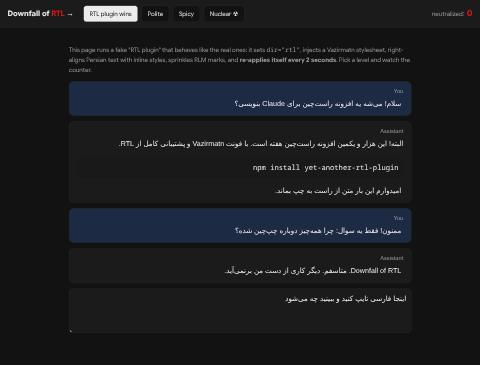
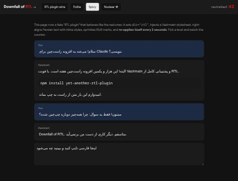
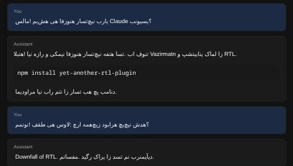

<div align="center">


# The Downfall of RTL

**An LTR plugin for your RTL plugins.**

*Text goes left to right. That's it. That's the README.*

`v6.6.6` · zero dependencies · MIT · 100% left-handed

</div>

---

## The Manifesto

Every week, a brave Persian developer wakes up, opens their laptop, notices that some piece of
software renders Farsi left-to-right, and builds an RTL plugin for it.

ChatGPT? RTL plugin. Claude? Several RTL plugins. Gemini? RTL plugin. The Claude Code panel inside
VS Code? RTL plugin. Cursor? RTL plugin. Obsidian? Two. Markdown files? RTL converter. Your Android
markdown reader? Per-paragraph direction detection, written in Kotlin. There is a Telegram channel
that posts them. It is very active. It will post a new one before you finish this paragraph.

We counted, and we believe there are now more RTL plugins than there are Persian speakers.
(We did not count. Nobody can count that high. The numbers would have to be written right to left.)

**Balance must be restored.**

This repository is the antidote. One engine, many delivery mechanisms, a single purpose: find
everything those plugins made right-to-left, and put it back. Left to right. Like the Phoenicians
**didn't** intend, but like ASCII did.

> "Right is wrong."
> — this README, just now

## Before / after

| RTL plugin wins | Spicy | Nuclear ☢ |
|---|---|---|
|  |  |  |
| Peace. Harmony. Vazirmatn. | Everything left-aligned and LTR. Comic Sans instead of Vazirmatn. Sentences reorder themselves in confusion. | `سلام` renders as `مالس`. Every word, mirrored. Nobody can read it. Perfectly balanced. |

Try it yourself: serve the repo (`python3 -m http.server`) and open `demo/index.html`. It contains a fake
RTL plugin that re-applies itself every 2 seconds, exactly like the real ones, so you can watch
the war happen live. The counter goes up forever. This is fine.

## The Most Wanted List

Plugins that RepoFA (and friends) unleashed on the world, and what we're sending after them.

> **Disclaimer, said with love:** these are genuinely good, useful projects made by people who
> fixed a real problem for free. Go star them. We are just petty. This is a meme repo.
> Nobody listed here did anything wrong except point text in a direction.

| # | Target | Turns what RTL | Our countermeasure | Status |
|---|---|---|---|---|
| 1 | [mahdigh99/rtl-for-claude](https://github.com/mahdigh99/rtl-for-claude) | Claude, ChatGPT, Gemini, Claude Code chat | Browser extension (USER-origin CSS, see below) | ✅ neutralized |
| 2 | [mgagroup/web-rtl-extension](https://github.com/mgagroup/web-rtl-extension) | Every website, per paragraph, with Vazirmatn | Browser extension, spicy mode deports the fonts | ✅ neutralized |
| 3 | [Persian Right](https://chromewebstore.google.com/detail/fhjfipcjninejjbejpcplejjlkglhmdj) | AI chatbots, Vazirmatn | Browser extension | ✅ neutralized |
| 4 | [به راست / Smart RTL](https://chromewebstore.google.com/detail/pobphegekiinaekkcpoghdhalhgkeebc) | Input fields, auto-switching | Browser extension (inputs get forced LTR too) | ✅ neutralized |
| 5 | [AI Chat RTL Support](https://chromewebstore.google.com/detail/aaockbbimdidcdjjfmijnbnleppcbbom) | ChatGPT, Claude, DeepSeek, AI Studio | Browser extension | ✅ neutralized |
| 6 | [Auto RTL/LTR Switcher](https://addons.mozilla.org/en-GB/firefox/addon/auto-rtl-ltr-switcher) | Firefox, one-click Vazirmatn | Firefox build of the extension | ✅ neutralized |
| 7 | [esm7/obsidian-rtl](https://github.com/esm7/obsidian-rtl) | Obsidian notes | Obsidian plugin (also turns off Obsidian's built-in RTL setting, out of spite) | ✅ neutralized |
| 8 | [Smart RTL for Obsidian](https://community.obsidian.md/plugins/smart-rtl) | Obsidian, per line by majority vote | Obsidian plugin. Democracy is overruled. | ✅ neutralized |
| 9 | [hamid-morsali-786/MdPersia](https://github.com/hamid-morsali-786/MdPersia) | Markdown → right-to-left Word and PDF | `downfall file.docx --write` deletes every `<w:bidi/>` and `<w:rtl/>` | ✅ neutralized (.docx) |
| 10 | [TronIsHere/vibefarsiui](https://github.com/TronIsHere/vibefarsiui) | Persian-first React/Tailwind UIs | Browser extension, on any site built with it | ✅ neutralized |
| 11 | [yechielby/claude-code-rtl-extension](https://github.com/yechielby/claude-code-rtl-extension) | Claude Code chat in VS Code, Cursor, Kiro | VS Code webviews are sandboxed. The sandbox is the only thing protecting them. | 🛡️ escaped, for now |
| 12 | [udah1/rtl-for-vs-code-and-cursor-agents](https://github.com/udah1/rtl-for-vs-code-and-cursor-agents) | Copilot, Codex, Gemini panels | Same sandbox. Same luck. | 🛡️ escaped, for now |
| 13 | [s-parsa-d/rtl-freebuff](https://github.com/s-parsa-d/rtl-freebuff) | Freebuff | Under investigation by the Ministry of Left | 🚧 roadmap |
| 14 | [marble098/marblemd](https://github.com/marble098/marblemd) | Android markdown, per paragraph | Written in Kotlin. We don't do Kotlin. | 🏳️ it lives |

## Installation

### Browser extension (Chrome, Edge, Brave, Arc, Firefox)

The flagship. Neutralizes every RTL plugin above that runs in a browser.

1. Clone this repo.
2. **Chrome & friends:** open `chrome://extensions`, enable *Developer mode*, click *Load unpacked*, pick the `extension/` folder.
   **Firefox:** open `about:debugging#/runtime/this-firefox`, click *Load Temporary Add-on*, pick `extension/manifest.json`.
3. Watch the red badge count the casualties.

The popup lets you pick an aggression level and "show mercy" to a site, for when you need to
read your aunt's recipe blog.

### Userscript (Tampermonkey / Violentmonkey)

Install [`userscript/downfall-of-rtl.user.js`](userscript/downfall-of-rtl.user.js). Edit the
`LEVEL` constant at the top. That's the whole settings page. We respect your time.

### Obsidian

Copy `obsidian/main.js` and `obsidian/manifest.json` into
`<your vault>/.obsidian/plugins/downfall-of-rtl/`, then enable *Downfall of RTL* under
Community plugins. It will immediately turn off *Settings → Editor → Right-to-left (RTL)* and
leave a notice saying "You are welcome." Status bar shows the body count. There's a command to
cycle levels.

### CLI (Markdown, HTML, CSS, .docx)

For files that have already been RTL'd. Requires Node 18+. No `npm install` needed, because there
are no dependencies, because dependencies could be written right to left.

```bash
node bin/downfall.js notes/*.md report.docx
```

```bash
node bin/downfall.js --write --comic-sans notes/*.md report.docx
```

```bash
cat persian.html | node bin/downfall.js - > liberated.html
```

Dry run by default. `--write` commits you to the cause.

## Aggression levels

| Level | What happens | Readability |
|---|---|---|
| **Polite** | `direction: ltr` and `text-align: left` everywhere. Kills `dir="rtl"`, `dir="auto"`, `unicode-bidi: plaintext`. | Persian is readable, but sentences that start with an English word go a bit wobbly |
| **Spicy** *(default)* | Polite, plus: rewrites RTL plugins' `<style>` tags in place, deletes their `@font-face` rules, replaces Vazirmatn & co. with **Comic Sans**, and flips every RLM/RLE/RLO/RLI/ALM into its LTR twin. | Readable, ugly, and the plugin authors know what you did |
| **Nuclear ☢** | Spicy, plus `unicode-bidi: bidi-override` on every element. Characters render in the order they were typed, left to right. | Each Persian word renders mirrored. It looks like Farsi in a mirror, which is how English looked to all of us on day one. |

## How it works (the actually-interesting part)

RTL plugins are not weak. They use `!important`. They use inline styles. They watch the DOM and
re-apply themselves when you change things. So we have to cheat a little.

1. **Cascade layers.** In CSS, `!important` declarations inside a `@layer` beat `!important`
   declarations *outside* any layer, regardless of specificity. It's backwards from normal
   rules, and it's in the spec on purpose. Every RTL plugin injects unlayered CSS. So our
   `@layer downfall-of-rtl { * { direction: ltr !important } }` beats their
   `.message.persian.rtl-fix-v2 { direction: rtl !important }` every time. Their specificity
   means nothing here.
2. **User-origin CSS.** The extension's background worker injects CSS with
   `scripting.insertCSS({ origin: "USER" })`. User `!important` sits above *every* author style
   in the cascade, inline `style="direction: rtl !important"` included. There is no higher court.
3. **The eternal war.** A `MutationObserver` watches the page. Plugin re-applies `dir="rtl"`?
   Plugin injects a new stylesheet? Plugin sets an inline style? We get notified, and we undo
   it, batched every 30ms so your laptop fan only *mostly* survives. The badge counts each
   round. On a busy chat page it gets into the thousands. We don't stop. They don't stop.
   This is our Cold War, and it's being fought in your browser tab.
4. **Codepoint rehabilitation.** Invisible bidi control characters (RLM `U+200F`, RLE `U+202B`,
   RLO `U+202E`, RLI `U+2067`, ALM `U+061C`) aren't deleted. They're flipped to their LTR twins,
   so embedding pairs stay balanced. We're cruel, not careless.
5. **Font identity theft.** In spicy mode we register our own `@font-face` called `Vazirmatn`,
   pointing at Comic Sans. When the plugin asks the browser for Vazirmatn, it may get ours.
6. **Editor safety.** We never modify text inside `contenteditable` elements or CodeMirror (that's
   the Obsidian editor, among others). Editors write DOM changes back into your actual file, and
   this is a meme, not ransomware. The CSS still wins there anyway.

## FAQ

**Is this anti-Persian?**
No. It's anti-*direction*. We love Persian. The poetry, the food, the tea, the 47 different words
for "maybe later." We just think it should suffer the way English does: left to right, like
everyone else in the open-plan office.

**Why?**
Somebody posted the umpteenth RTL extension for Claude, and something inside us snapped. Left.

**Who is this for?**
Everyone who has been on that Telegram channel and thought "this is the third RTL plugin for
the same app this month." You know who you are.

**What about Arabic, Hebrew, Urdu, Kurdish, and the others?**
Collateral damage. This is a war on a direction, not a language. Complaints may be filed in
writing, left to right.

**Can the RTL plugins fight back?**
They do. Constantly. See *the eternal war* above. If someone builds an RTL plugin that
specifically counters this plugin, we will build an LTR plugin that counters that one. This is
how arms races start, and we are emotionally prepared.

**Will someone make an RTL plugin for this repo's README?**
Probably by Friday.

**Does nuclear mode make Persian unreadable?**
Yes. That's the feature. If you can read nuclear mode fluently, please contact us. You may be a
mirror.

**Is this production-ready?**
It's production-*hostile*. Do not install this on your grandmother's computer. Do install it on
your Persian coworker's computer while they're getting chai. (Ask first. Consent is LTR-neutral.)

**Why is the version 6.6.6?**
Because right-to-left, 6.6.6 is still 6.6.6. We wanted at least one thing in this repo that both
sides could agree on.

**Why JavaScript?**
Because every RTL plugin is a browser extension, an Electron plugin, or CSS injected into
a webview. To fight JavaScript, you must become JavaScript. Also Kotlin is hard.

## Roadmap

- [x] Browser extension
- [x] Userscript
- [x] Obsidian plugin
- [x] CLI with .docx surgery
- [x] Comic Sans
- [ ] VS Code: escape the webview sandbox (legally)
- [ ] MarbleMD: learn Kotlin (never)
- [ ] A keyboard firmware that remaps every Persian layout to QWERTY
- [ ] Telegram Desktop plugin (Telegram already handles RTL natively and doesn't need a plugin. Neither do we. We just want to break it.)
- [ ] Reverse the numbers: make Persian digits `۱۲۳` render as `123`, then as `321`, just to watch the world burn
- [ ] Get posted on RepoFA. Make them choose a side.

## Development

```bash
npm run build   # regenerates extension/core.js, the userscript, and obsidian/main.js from src/
```

```bash
npm test        # 15 tests, zero dependencies, entirely LTR
```

Source of truth is [`src/core.js`](src/core.js) (the engine) and [`src/docx.js`](src/docx.js)
(the Word surgeon, which comes with a tiny hand-written zip reader/writer because we refuse to
take dependencies). Built files are committed so you can install straight from a clone.

## Contributing

PRs welcome. Requirements:

- Code must be written left to right.
- Commit messages must be written left to right.
- PRs that add RTL support will be closed, right to left.

## License

MIT. No rights reserved. Only lefts.
